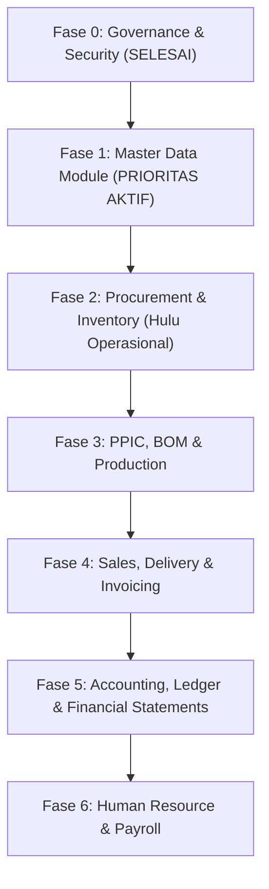

# 00 - Master Product Requirement Document (PRD)
## Hiruta Kogyo Indonesia (HKI) ERP Modernization & Migration

---

## 1. Executive Summary & Objective

Proyek ini bertujuan memigrasikan sistem enterprise resource planning (ERP) lama berbasis PHP Native (`erp_old_with_native_php`) ke arsitektur modern berbasis:
- **Backend**: Laravel 12, PHP 8.2+, MySQL / MariaDB (InnoDB, Foreign Keys, UUID Primary Keys, 3NF).
- **Frontend**: Inertia.js v2, Vue 3 (Composition API, `<script setup>`), Tailwind CSS, dan metodologi **Atomic Design**.
- **Security & Governance**: Spatie Laravel-Permission (Role & Permission-based Access Control), CSRF Protection, Prepared Statements (Eloquent ORM), Audit Logging (`activity_logs`), dan Soft Deletes / Recycle Bin.

Acuan struktur menu dan modul diambil langsung dari skema produksi riil sistem legacy pada tabel `adminofficer_menu` di dalam berkas [hkiandon.sql](file:///Users/restuah/Herd/erp/erp_old_with_native_php/hkiandon.sql).

---

## 2. Pemetaan Modul Utama (Berdasarkan `adminofficer_menu`)

Berdasarkan ekstraksi 171 data menu riil dari tabel `adminofficer_menu`, arsitektur ERP dipetakan menjadi 7 pilar modul utama:

| No | Modul Legacy (`adminofficer_menu`) | Parent ID | Domain Sistem Modern | File Referensi Utama |
|---|---|---|---|---|
| 1 | **MISCELLANEOUS** | 2 | Access Control, User & System Governance | `user.php`, `modulmaster.php`, `log-aktivitas.php` |
| 2 | **MASTER** | 30 | Master Data & Parameter Konfigurasi Bisnis | `calendar.php`, `budget-master.php`, `coa-master.php`, `item-master.php`, dll. |
| 3 | **PROCUREMENT / PURCHASING** | 88 | Purchasing & Material Procurement (MM-PUR) | `direct-po.php`, `indirect-po.php`, `receiving-direct.php`, dll. |
| 4 | **INVENTORY / WAREHOUSE** | 56 | Warehouse Management & Stock Control (MM-IM/WM)| `stock-control.php`, `material-control.php`, `wip-control.php`, dll. |
| 5 | **PRODUCTION / PPIC** | 55, 63 | Production Planning, BOM Explosion & MRP (PP) | `mrp.php`, `production-plan.php`, `explosion-list.php`, dll. |
| 6 | **SALES & MARKETING** | 69, 75 | Sales Orders, Delivery Schedules & Invoicing (SD)| `sales-order-processing.php`, `delivery-plan.php`, `invoice-customer.php` |
| 7 | **ACCOUNTING / FINANCE** | 98 | Financial Ledger, AP/AR, Assets & Cashflow (FI/CO)| `journal.php`, `ledger.php`, `fixed-asset.php`, `financial_statement.php` |
| 8 | **HUMAN RESOURCE** | 101, 185 | HCM, Absensi Mesin, Shift, & Payroll PPh 21 | `employee_list.php`, `shift_setup.php`, `hr_payroll_*.php` |

---

## 3. Prinsip Arsitektur & Aturan Pengembangan Wajib

Sesuai panduan tata kelola repositori ([development-standards.md](file:///Users/restuah/Herd/erp/.agents/rules/development-standards.md)):

### 3.1. Keamanan & Backend Route Permission
1. **Validasi Permission di Backend Adalah Mutlak**:
   Setiap route dalam `routes/web.php` wajib dilindungi middleware Spatie:
   - `middleware('permission:<module>.<action>')` (contoh: `permission:departments.view`, `permission:departments.create`).
   - `middleware('role:Superadmin')` untuk rute khusus administrasi sistem.
2. **UI Hiding Bukan Keamanan**:
   Penyembunyian tombol atau menu di Vue (`v-if="can(...)"`) hanyalah kenyamanan visual (UX). Akses endpoint controller tanpa permission harus menghasilkan `403 Forbidden`.
3. **Automated Test Coverage**:
   Setiap penambahan atau modifikasi route wajib diuji dengan Feature Test:
   - Pengguna unauthenticated diarahkan ke login (`302`).
   - Pengguna tanpa permission menerima `403 Forbidden`.
   - Pengguna berhak / Superadmin mendapatkan respon sukses (`200 OK`).

### 3.2. Frontend & Atomic Design Hierarchy
Semua antarmuka dibuat menggunakan komponen bertingkat:
- `Atoms` (`resources/js/Components/Atoms/`): Elemen tunggal (`Button`, `TextInput`, `Icon`, `Badge`, `Avatar`).
- `Molecules` (`resources/js/Components/Molecules/`): Gabungan atom sederhana (`FormField`, `SearchInput`, `Pagination`).
- `Organisms` (`resources/js/Components/Organisms/`): Komponen mandiri kompleks (`AppSidebar`, `AppHeader`, `ModalDialog`, `DataTable`).
- `Templates` (`resources/js/Components/Templates/`): Layout struktural (`AuthenticatedTemplate`, `GuestTemplate`).
- `Pages` (`resources/js/Pages/`): Tampilan halaman penuh Inertia.

---

## 4. Roadmap Rilis Bertahap (Phased Releases)

- **Fase 0 (Selesai)**: Auth, Profil, 2FA, Spatie Roles & Permissions, Recycle Bin, Audit Log.
- **Fase 1 (Aktif)**: Kelengkapan Modul Master Data (berdasarkan `adminofficer_menu` ID 30 & 185).
- **Fase 2**: Procurement & Inventory (PR, PO Direct/Indirect, Receiving, Stock & Material Control).
- **Fase 3**: PPIC & Produksi (BOM Explosion, MRP, Production Planning, NG Reporting).
- **Fase 4**: Sales & Distribusi (Sales Order, Delivery Schedule, Customer Invoicing, Delivery Note).
- **Fase 5**: Accounting & Finance (COA, Journal Voucher, General Ledger, AP/AR, Fixed Assets, Financial Statements).
- **Fase 6**: HR & Payroll (Data Karyawan, Shift, Mesin Absensi, Overtime, Payroll & PPh 21).
