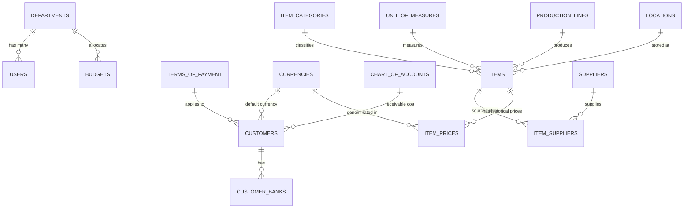

# 01 - Product Requirement Document (PRD)
## Modul Master Data (Core Foundation)

---

## 1. Latar Belakang & Tujuan Bisnis

Modul **Master Data** merupakan pondasi utama dari seluruh siklus operasional ERP PT Hiruta Kogyo Indonesia (HKI). Semua transaksi hulu (Purchasing, Receiving) dan hilir (Production Planning, Sales, Invoicing, General Ledger) bergantung pada validitas, konsistensi, dan integritas data master.

### Masalah di Sistem Legacy (`erp_old_with_native_php`):
1. **Denormalisasi Ekstrem & Redundansi Kolom**:
   - Di `item_master`, supplier alternatif disimpan sebagai kolom kaku: `idSupplier`, `idSupplier2`, `idSupplier3`, `unitprice`, `unitprice2`, `unitprice3`.
   - Harga disimpan dalam `longtext` tidak terstruktur (`priceList`).
2. **Ketiadaan Foreign Keys & Integritas Relasional**:
   - Penghubung antar tabel hanya mengandalkan string atau ID tanpa constraint relasional database (banyak data *orphan*).
3. **Pemisahan Entitas yang Inkonsisten**:
   - Barang beli (`item_master`) dan barang jadi (`product`) dibuat di dua tabel terpisah yang sama sekali berbeda strukturnya, menyulitkan standarisasi stok dan valuasinya.
4. **Celah Keamanan & Validasi**:
   - Skrip input master data di legacy tidak memiliki proteksi CSRF, tidak menggunakan validasi Form Request, dan rentan injeksi SQL langsung via parameter GET/POST.

---

## 2. Inventarisasi Menu Master Data (Berdasarkan `adminofficer_menu`)

Daftar berikut merangkum seluruh menu Master Data dari tabel `adminofficer_menu` (Parent ID: `30`, `2`, dan `185`):

| ID Legacy | Menu Legacy | File Legacy | Status di Laravel Modern | Tindakan / Rekomendasi |
|---|---|---|---|---|
| **31** | Calendar Master | `calendar.php` | ✅ **Implemented** | Model `CalendarDay`, route `calendar.*` |
| **33** | Budget Master | `budget-master.php` | ✅ **Implemented** | Model `Budget`, `BudgetClassification`, `BudgetChecker` |
| **105** | COA Master | `coa-master.php` | ✅ **Implemented** | Model `ChartOfAccount`, route `chart-of-accounts.*` |
| **53** | UOM Master | `uom-master.php` | ✅ **Implemented** | Model `UnitOfMeasure`, route `unit-of-measures.*` |
| **220** | Currency | `master_currency.php` | ✅ **Implemented** | Model `Currency`, route `currencies.*` |
| **219** | Exchange Rates | `master-exchange-rates.php`| ✅ **Implemented** | Model `ExchangeRate`, route `exchange-rates.*` |
| **46, 47, 48** | Supplier Master (Direct & Indirect) | `supplier.php`, `supplier-indirect.php` | ✅ **Implemented** | Model `Supplier`, `TermOfPayment`, route `suppliers.*` |
| **3** | User Master | `user.php` | ✅ **Implemented** | Model `User`, Spatie RBAC, 2FA, `users.*` |
| **32** | Department Master | `department-master.php` | ✅ **Implemented** | Model `Department`, route `departments.*`, relasi `users` & `budgets` |
| **49** | Customer Master | `customer.php` | ✅ **Implemented** | Model `Customer`, `CustomerBank`, route `customers.*`, relasi `term_of_payments`, `currencies`, `chart_of_accounts` |
| **169** | Classification Master | `classification-master.php`| ⏳ **Needs Implementation** | Kategori klasifikasi barang/biaya |
| **50, 172** | Location & Production Location | `location-master.php`, `production-location.php` | ⏳ **Needs Implementation** | Lokasi gudang / rak penyimpanan |
| **54, 36, 166** | Items & Product Master | `item-master.php`, `product.php`, `salesitemmaster.php` | ⏳ **Needs Implementation** | Model unifikasi `Item` & `Product` |
| **41, 42, 43, 44, 45** | Price Master & Standard Cost | `purchase-price-master.php`, `sales-price-master.php`, `standard-cost.php` | ⏳ **Needs Implementation** | Relasional riwayat harga & effective date |
| **34, 35** | Production Line Master | `line.php` | ⏳ **Needs Implementation** | Line produksi & cycle time |
| **162, 163, 221, 222** | Fleet & Driver (Vehicle, Forklift) | `vehicle_master.php`, `driver_master.php`, `master_forklift.php` | ⏳ **Needs Implementation** | Master aset armada operasional pabrik |
| **37, 38, 39, 40** | Structure Master (BOM Explosion) | `explosion-list.php`, `purchase-item.php`, `production-item.php` | ⏳ **Needs Implementation** | Masuk ke Fase PPIC / Produksi |

---

## 3. Rencana Arsitektur & Skema Database Ternormalisasi

Untuk mengatasi kelemahan arsitektur legacy, berikut rancangan entitas baru yang ternormalisasi (3NF) dengan foreign key dan audit trail:

### 3.1. Tabel `departments`
Menggantikan `department_master` legacy:
- `id`: uuid PK (standar UUID arsitektur modern ERP HKI)
- `code`: varchar(50) unique (contoh: `ACC`, `PUR`, `PROD`, `PPIC`, `HRD`)
- `name`: varchar(150)
- `manager_id`: foreignUuid FK ke `users.id` (nullable)
- `description`: text nullable
- `is_active`: boolean default true
- `created_by`, `updated_by`: foreignUuid FK ke `users.id` (nullable)
- `timestamps`, `softDeletes`

### 3.2. Tabel `customers` & `customer_banks`
Menggantikan `customer` legacy (mengadopsi pola model `Supplier` yang sudah mapan):
- `customers` table:
  - `id`: uuid PK (standar UUID arsitektur modern ERP HKI)
  - `customer_code`: varchar(50) unique
  - `name`: varchar(255)
  - `alias`: varchar(100) nullable
  - `tax_id` (NPWP): varchar(50) nullable
  - `term_of_payment_id`: foreignUuid FK ke `term_of_payments.id` (nullable)
  - `currency_id`: foreignUuid FK ke `currencies.id` (nullable)
  - `coa_receivable_id`: foreignUuid FK ke `chart_of_accounts.id` (nullable)
  - `phone`, `fax`, `email`: varchar nullable
  - `contact_person`, `contact_person_phone`, `contact_person_email`: varchar nullable
  - `billing_address`, `shipping_address`, `tax_address`: text nullable
  - `delivery_lead_time_days`: integer default 0
  - `is_active`: boolean default true
  - `notes`: text nullable
  - `created_by`, `updated_by`: foreignUuid FK ke `users.id` (nullable)
  - `timestamps`, `softDeletes`
- `customer_banks` table:
  - `id`: uuid PK
  - `customer_id`: foreignUuid FK ke `customers.id` (cascadeOnDelete)
  - `bank_name`: varchar(100)
  - `bank_account_number`: varchar(50) index
  - `bank_account_name`: varchar(150)
  - `bank_branch`: varchar(100) nullable
  - `swift_code`: varchar(50) nullable
  - `is_primary`: boolean default false
  - `timestamps`

### 3.3. Unifikasi Entitas Barang (`items`)
Menyatukan `item_master` (barang beli/material), `product` (barang jadi), dan `salesitemmaster`:
- `id`: uuid PK (standar UUID arsitektur modern ERP HKI)
- `code`: varchar(100) unique (Part Number / SKU)
- `name`: varchar(255)
- `type`: enum(`raw_material`, `wip`, `finish_good`, `consumable`, `service`)
- `item_classification_id`: foreignUuid FK ke `item_classifications.id` nullable
- `unit_of_measure_id`: foreignUuid FK ke `unit_of_measures.id`
- `chart_of_account_id`: foreignUuid FK ke `chart_of_accounts.id` nullable (Akun persediaan / beban)
- `minimum_stock`: decimal(15,2) default 0
- `cycle_time_seconds`: decimal(10,3) default 0 (khusus finish good di lini produksi)
- `production_line_id`: foreignUuid FK ke `production_lines.id` nullable
- `location_id`: foreignUuid FK ke `locations.id` nullable
- `is_active`: boolean default true
- `created_by`, `updated_by`: foreignUuid FK ke `users.id` (nullable)
- `timestamps`, `softDeletes`

### 3.4. Tabel Relasi Sourcing: `item_suppliers`
Menghilangkan kolom anomali `idSupplier`, `idSupplier2`, `idSupplier3`:
- `id`: uuid PK
- `item_id`: foreignUuid FK ke `items.id` (cascadeOnDelete)
- `supplier_id`: foreignUuid FK ke `suppliers.id` (cascadeOnDelete)
- `priority`: tinyint (1 = Primary, 2 = Secondary, dst.)
- `supplier_item_code`: varchar(100) nullable
- `lead_time_days`: integer default 0
- `timestamps`

### 3.5. Tabel Histori Harga: `item_prices`
Menghilangkan format `longtext priceList`:
- `id`: uuid PK
- `item_id`: foreignUuid FK ke `items.id` (cascadeOnDelete)
- `type`: enum(`purchase`, `sales`, `standard_cost`)
- `currency_id`: foreignUuid FK ke `currencies.id`
- `unit_price`: decimal(18,4)
- `effective_date`: date
- `expired_date`: date nullable
- `is_active`: boolean default true
- `created_by`, `updated_by`: foreignUuid FK ke `users.id` (nullable)
- `timestamps`

---

## 4. Matriks Role & Permissions (Spatie RBAC)

Mengikuti aturan ketat [development-standards.md](file:///Users/restuah/Herd/erp/.agents/rules/development-standards.md), setiap submodul Master Data wajib memiliki permission slug tersendiri:

| Sub-Modul | View Permission | Create Permission | Edit Permission | Delete / Restore Permission |
|---|---|---|---|---|
| **Departments** | `departments.view` | `departments.create` | `departments.edit` | `departments.delete`, `departments.restore` |
| **Customers** | `customers.view` | `customers.create` | `customers.edit` | `customers.delete`, `customers.restore` |
| **Items (Parts/Products)** | `items.view` | `items.create` | `items.edit` | `items.delete`, `items.restore` |
| **Item Classifications** | `item-classifications.view` | `item-classifications.create` | `item-classifications.edit` | `item-classifications.delete` |
| **Locations / Warehouses**| `locations.view` | `locations.create` | `locations.edit` | `locations.delete` |
| **Production Lines** | `production-lines.view` | `production-lines.create` | `production-lines.edit` | `production-lines.delete` |
| **Vehicles & Drivers** | `fleet.view` | `fleet.create` | `fleet.edit` | `fleet.delete` |

> **Catatan Tata Kelola Restore / Recycle Bin:** Permission `departments.restore` dan `customers.restore` didaftarkan pada Spatie RBAC untuk role `Superadmin` dan `Admin`. Seluruh eksekusi pemulihan data (single/bulk restore) dan penghapusan permanen (force delete) dikelola secara terpusat melalui modul Recycle Bin (`RecycleBinController`), memastikan audit trail aktivitas pemulihan data tercatat transparan.

---

## 5. Standar UI/UX & Atomic Design Hierarchy

Sesuai aturan frontend proyek:
1. **Atoms** (`resources/js/Components/Atoms/`):
   - Gunakan `TextInput`, `SelectInput`, `CurrencyInput`, `Badge`, `Button`, `IconButton`.
2. **Molecules** (`resources/js/Components/Molecules/`):
   - `FormField` (Label + Input + Validation Error).
   - `SearchInput` & `FilterDropdown`.
   - `Pagination` & `ConfirmationModal`.
3. **Organisms** (`resources/js/Components/Organisms/`):
   - `DataTable` dengan sorting, paginasi dinamis, dan batch action.
   - Form modal / slide-over (`DepartmentFormModal`, `CustomerFormModal`, `ItemFormModal`).
4. **Mobile-First Responsiveness**:
   - Tampilan tabel desktop bertransisi menjadi card layout responsif pada layar ponsel (< 640px).
   - Tidak boleh ada *horizontal window overflow*.
   - Target sentuh minimal 44x44px.

---

## 6. Urutan Eksekusi Pengembangan Modul Master Data

Berdasarkan dependensi data bisnis:

### Tahap 1: Struktur Organisasi & Mitra Bisnis (Langkah Berikutnya)
1. **Department Master** (✅ SELESAI):
   - Migrasi skema `departments` dan foreign key pada `users` & `budgets`.
   - Seeder permission `departments.*` & Seeder standar departemen HKI.
   - Controller, Model dengan audit log, relasi `users`, `budgets`, dan `manager`.
   - Vue Pages (Atomic Design) & Feature Test proteksi permission.
2. **Customer Master** (✅ SELESAI):
   - Migrasi skema `customers` dan `customer_banks`.
   - Seeder permission `customers.*` & `CustomerSeeder` mitra OEM HKI (ADM, TMMIN, HPM, SIM, MMKI).
   - Relasi ke `term_of_payments`, `currencies`, `chart_of_accounts` (AR Piutang Usaha), dan `customer_banks`.
   - Integrasi penuh Recycle Bin (Soft delete, Restore, Force delete).
   - Vue Pages (Atomic Design, Mobile-first) & Feature Test komprehensif.

### Tahap 2: Manajemen Material & Barang
3. **Item Classifications & Locations**:
   - `item_classifications` & `locations`.
4. **Unified Items (Raw Material, WIP, Finish Good)**:
   - Migrasi skema `items`, `item_suppliers`, `item_prices`.
   - Integrasi UOM, Currency, dan Supplier.

### Tahap 3: Fasilitas & Armada Pabrik
5. **Production Line Master**:
   - `production_lines` (Line number, cycle time, status).
6. **Fleet & Driver Master**:
   - `vehicles`, `drivers`, `forklifts`.
